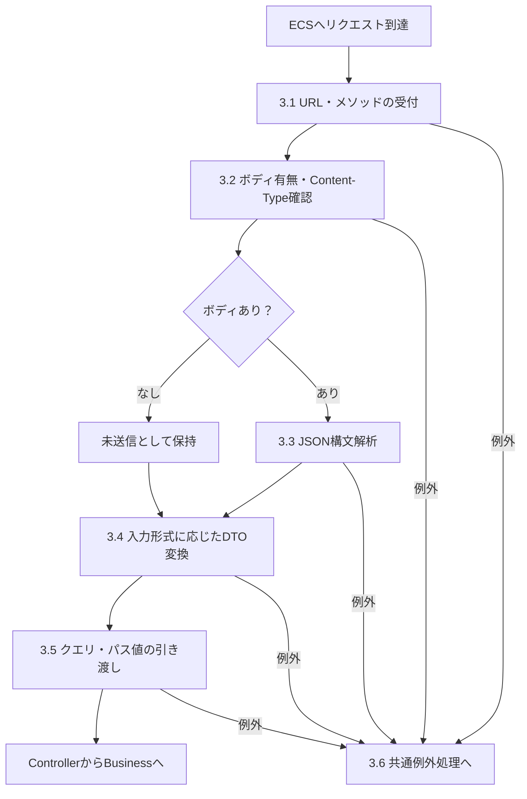

# COM001_10_HTTP共通受付・JSON構文解析

## 0. 処理フロー



## 1. 基本情報

| 項目 | 内容 |
| --- | --- |
| 機能ID | COM001_10 |
| 論理名 | HTTP共通受付・JSON構文解析 |
| 物理名 | parse-http-request |
| 実装部品 | HttpRequestSupport／JSON converter |
| 実行位置 | Spring MVCのController引数解決・JSON変換時。URL・メソッド判定はSpring MVCに委譲する |
| 対象 | ECSのJSON業務API。S3直接アップロード、ヘルスチェック、CORSプリフライトは対象外 |
| 入力 | HTTPメソッド、Content-Type、ボディ、クエリ、パス変数、受付先の入力型 |
| 出力 | 解析済み入力。異常時はCOM001_08へ例外を渡す |
| DB・外部通信 | なし |

**最新仕様との整理：** 機能一覧には「JSONツリーを渡し、項目の許否はBusiness」とあるが、後に更新されたGL-11では「DTO変換・未定義JSON項目の拒否はCOM001_10」となっている。本書はGL-11を採用する。未送信／null／任意JSONの区別が必要なAPIだけJSONツリーを渡し、Businessで判定する。機能一覧そのものは本書の作成では変更しない。

### 1.1 実装の分担

| 部品 | 実施内容 |
| --- | --- |
| Spring MVC | URL・メソッドの対応付け、引数解決の起動 |
| HttpRequestSupport | ボディ有無の保持、JSON解析・DTO変換、クエリの複数値保持 |
| 個別Controller | 共通受付の出力をBusinessへ渡す。共通受付をメソッド内で再実行しない |
| 個別Business | DTOの単項目チェック、整形、項目間チェック、DB処理 |

認証コンテキストの確認はCOM001_02の担当。本機能でJWT検証や会員検索を重ねない。親ControllerにはJSON解析を実装しない。引数解決はControllerメソッドが呼ばれる前に実行されるため、共通受付をMVC設定で一度だけ登録する。

## 2. 入力・実装インターフェース

### 2.1 入力項目

| 項目 | 取得元 | 共通受付で行う確認 |
| --- | --- | --- |
| URL・HTTPメソッド | HttpServletRequest | 登録済みの業務ルートと一致すること |
| Content-Type | HTTPヘッダー | ボディありの場合、application/jsonであること。charset指定時はUTF-8 |
| ボディ | InputStream | 未送信判定、サイズ上限、JSON構文、入力型への変換 |
| クエリ | Servletのパラメータ情報 | 名前と全値を保持する。必須・文字数・許可名・重複可否はBusiness |
| パス変数 | Spring MVCの解決結果 | 文字列のまま渡す。ID形式・値の範囲はBusiness |
| 入力型・受付方式 | Controller側の宣言 | サーバー定義。利用者から型名やクラス名を受け取らない |

### 2.2 受付方式

| 方式 | 使用場面 | Businessに渡す内容 |
| --- | --- | --- |
| DTO方式 | 通常の登録・更新API | API専用DTO。必須ボディなし／JSON nullは受付エラー |
| JSONツリー方式 | 会員初期化のようにボディ未送信・null・空オブジェクトを個別に判定するAPI | bodyPresentとJsonNode。ボディ許否・ルート型はBusiness |
| ボディなし方式 | 一覧取得等 | ボディ未送信を確認してクエリ・パス値を渡す。ボディありはINVALID_REQUEST |

実装案は、専用の`@ApiInput`と`HandlerMethodArgumentResolver`で`ParsedHttpInput<T>`を生成する方式とする。DTO方式はTをAPI専用DTO、JSONツリー方式はTをJsonNodeとする。起動時にTと受付方式の組み合わせを検査し、不適合なら起動エラーとする。

```java
public record ParsedHttpInput<T>(
    boolean bodyPresent,
    T body,
    Map<String, List<String>> query,
    Map<String, String> pathVariables
) {}

// Controller例：個別の単項目チェックは行わない
public ResponseEntity<?> execute(
        @ApiInput ParsedHttpInput<AddCartItemRequest> input) {
    return success(business.execute(input)); // successは親Controllerの正常応答処理
}
```

上記は構造例。`@ApiInput`を自作する場合は、引数解決部品の登録と対象型判定が必要。同じ引数に`@RequestBody`・`@Valid`・`@Validated`を併用しない。Spring標準の`@RequestBody`方式を採用するAPIでは、同等の設定をconverterに適用し、二つの経路でボディを読み取らない。

## 3. 処理詳細

### 3.1 URL・メソッドの受付

| 条件 | 処理・分岐 |
| --- | --- |
| URL・メソッドが一致 | 3.2へ進む |
| 登録済みURLだがメソッド不一致 | METHOD_NOT_ALLOWEDとして3.6へ |
| ECS業務APIの未定義URL | INVALID_REQUESTとして3.6へ。商品・注文の不存在とは区別する |

URLごとの対応表を本機能に別途複製せず、Controllerのマッピングを使用する。未定義APIが静的ファイルの処理やHTMLエラーへ流れないよう、APIパスの未検出例外もCOM001_08で捕捉する。

HEAD・OPTIONS等のフレームワーク標準処理や基盤応答は通常の業務API応答と区別する。Gatewayで拒否された要求は本機能に到達しない。

### 3.2 ボディ有無・Content-Type確認

1. ボディのInputStreamを上限付きで一度だけ読む。Content-Lengthのみで未送信と判定しない。
2. 実バイト数が0なら`bodyPresent=false`。1バイト以上なら`true`。
3. ボディありの場合はContent-Typeを確認する。

| 条件 | 処理・分岐 |
| --- | --- |
| ボディ0バイト | 3.4へ。JSON構文解析を行わない |
| ボディあり、application/json | 3.3へ |
| ボディあり、Content-Type未指定／不正／非対応 | UNSUPPORTED_MEDIA_TYPEとして3.6へ |
| charset指定がUTF-8以外 | UNSUPPORTED_MEDIA_TYPEとして3.6へ |
| 設定されたボディ上限超過 | INVALID_REQUESTとして3.6へ。全文の読取りを続けない |

JSONボディ上限は設定値`app.http.max-json-body-bytes`で管理する。初期実装案は1,048,576バイト（1MiB）。個別APIで大きなJSONを扱う場合は要求サイズに合わせて確定する。S3へ直接送信する画像サイズとは別の設定とする。

ボディなし・空文字・JSON nullを混同しない。空白だけのボディは「あり」であり、JSON値がないため構文エラーとする。

### 3.3 JSON構文解析

JacksonでJSONツリーを生成する。APIに関係なく文字列をトリム・数値化しない。

| チェック | 処理 |
| --- | --- |
| JSON構文 | 括弧不足、末尾カンマ、コメント等の非標準構文は拒否 |
| ルート値 | 1個だけ許可。`{} {}`等の複数値や後続の非空白データは拒否 |
| 同一オブジェクトの重複キー | 拒否する。後勝ちで値を上書きしない |
| 文字コード | UTF-8として不正なバイト列を拒否。文字化けした代替文字に置き換えない |
| 解析制限 | ネスト深さ等のJackson制約を有効化し、上限超過を入力エラーとする |

構文・解析制限違反はINVALID_REQUESTとして3.6へ進む。構文が正しければ3.4へ進む。JSONのルートが文字列・数値・配列であること自体は構文エラーではない。

Jackson 2系の設定対応例：重複キーは`STRICT_DUPLICATE_DETECTION`、末尾値は`FAIL_ON_TRAILING_TOKENS`。ツリー解析後にparserの次トークンがEOFであることを確認する実装でもよい。依存バージョンに応じた設定APIを使用し、初期値に依存しない。

### 3.4 入力形式に応じたDTO変換

#### DTO方式

| 条件 | 処理・分岐 |
| --- | --- |
| bodyPresent=false／JSON null | INVALID_REQUESTとして3.6へ |
| API専用DTOへ変換できる | 3.5へ |
| 未定義JSON項目・型不一致・数値型の表現範囲超過 | INVALID_REQUESTとして3.6へ |
| DTOやデシリアライザーの定義不備 | INTERNAL_ERRORとして3.6へ。利用者の入力エラーにしない |

| 変換設定 | 方針 |
| --- | --- |
| 未定義項目 | `FAIL_ON_UNKNOWN_PROPERTIES=true`。黙って破棄しない |
| 必須項目未送信・明示null | 原則nullとしてDTOへ保持。Businessの@NotNull等で判定 |
| 数値・真偽値 | Integer／Long／Boolean等のラッパー型を使用。未送信を0／falseで補完しない |
| 暗黙の型変換 | 文字列→数値、数値→文字列、小数→整数、単一値→配列を原則拒否。型ごとのcoercion設定を明示する |
| 未定義enum | nullや既定値に置き換えず拒否。業務側でコード判定する場合はStringで受ける |
| 項目値の制約 | @NotNull・@Size・@Min等の検証はここでは実行しない |

`FAIL_ON_UNKNOWN_PROPERTIES`だけで型変換全体は厳密にならない。たとえば数量の`"2"`、`2.5`、`true`をIntegerへ暗黙変換しない設定を確認する。DTO定義の`ignoreUnknown=true`等で受付方針を回避しない。

#### JSONツリー方式

| 受信ボディ | bodyPresent | body |
| --- | --- | --- |
| 未送信 | false | Javaのnull |
| `null` | true | NullNode |
| `{}` | true | 空のObjectNode |
| `[]` | true | 空のArrayNode |
| `""` | true | 空文字のTextNode |

上記を保持して3.5へ進む。許容する組み合わせ、ルート型、項目名・値のチェックは利用先Businessに記載する。JSONツリー方式にDTOの未定義項目拒否設定は適用できないため、Businessで許可項目を照合する。

### 3.5 クエリ・パス値の引き渡し

| 対象 | 処理 |
| --- | --- |
| クエリ名・値 | Servletでデコードされた値を使用。再度URLデコードしない |
| 同名クエリ | Listで全値を保持。先頭・末尾の1件に勝手に絞らない |
| 未指定／空文字 | 未指定はMapにキーなし、`?keyword=`は空文字の値として保持 |
| パス変数 | Spring MVCが解決した値をStringとして保持 |
| 型・必須・文字数・許可項目・重複可否 | 個別Businessへ委譲 |

`ParsedHttpInput`を作成してControllerへ返す。ControllerはBusinessを一度呼び出す。Businessの検証に失敗した場合はDB更新へ進まない。

クエリとJSONボディの同名項目を統合しない。MapとListは変更不可のコピーを渡し、後続処理で元の受付情報が書き換わらないようにする。

### 3.6 共通例外処理へ

**共通機能使用：COM001_08 共通例外処理**

| 入力 | 出力・後続処理 |
| --- | --- |
| 発生例外、判別済みコード、requestId、処理位置 | HTTP 200の共通エラーJSON。Controller／Businessは実行しない |

本機能はエラーJSONを自作しない。COM001_08がCOM001_07の応答生成とCOM001_09のログ出力を使用するため、本機能から重複してエラーログを出さない。生ボディ、クエリ値、Jacksonの例外メッセージを応答・ログへそのまま載せない。

## 4. Exception発生時・データ復旧

| 発生箇所・例外例 | error.code | message |
| --- | --- | --- |
| メソッド不一致／HttpRequestMethodNotSupportedException | METHOD_NOT_ALLOWED | この操作は指定された方法では実行できません。 |
| Content-Type不適合／HttpMediaTypeNotSupportedException | UNSUPPORTED_MEDIA_TYPE | リクエストの形式が正しくありません。 |
| 構文不正・未定義項目・入力型不一致等の読み取り失敗 | INVALID_REQUEST | リクエストの内容が正しくありません。 |
| 未定義の業務APIルート、ボディ必須違反・上限超過 | INVALID_REQUEST | リクエストの内容が正しくありません。 |
| DTO定義不備・想定外の内部例外 | INTERNAL_ERROR | 処理を完了できませんでした。 |

`HttpMessageNotReadableException`等のラッパー名だけで一律にINVALID_REQUESTへ変換せず、入力不正か実装不備かを原因例外から区別する。クライアント切断等で書込み不能の場合はHTTP 200を保証できない。自動再実行は行わない。

| DB項目 | 内容 |
| --- | --- |
| 検索・登録・更新・削除 | すべてなし |
| トランザクション・ロック | 開始しない |
| 復旧 | 本機能内の変更がないためDBロールバック・補償更新は不要 |
| 再実行 | 入力不正は要求修正後に再送。内部不備は修正後に再実行 |

「Business開始前の今回の要求は未更新」と「同じ操作の以前の要求も未更新」は別。以前の要求がタイムアウトした更新操作は、個別APIの操作結果照会・べき等性仕様に従う。

## 5. 確認ケース

| 入力・状態 | 期待結果 |
| --- | --- |
| 正常JSON、API専用DTOと一致 | DTOをBusinessへ渡す |
| DTO必須ボディ未送信／JSON null | INVALID_REQUEST、Business未実行 |
| JSONツリー方式の未送信／null／{} | 区別を維持してBusinessへ渡す |
| ボディが空白だけ／{}の後に{} | INVALID_REQUEST |
| 同一キーを2回指定 | INVALID_REQUEST |
| DTOにないisAdmin等の項目 | INVALID_REQUEST |
| DTO必須項目が未送信だがJSON自体は正常 | DTOへnullを保持し、BusinessのValidatorでVALIDATION_ERROR |
| Integerへ文字列数値・小数・真偽値 | INVALID_REQUEST |
| 同名クエリが2個 | 両方保持。許否はBusiness |
| application/json以外のボディ | UNSUPPORTED_MEDIA_TYPE |
| ボディ上限ちょうど／上限+1バイト | 前者は解析続行、後者はINVALID_REQUEST |
| DTO実装不備 | INTERNAL_ERROR。入力修正を利用者に要求しない |

## 6. 参照資料

- [機能一覧・エラーコード](https://docs.google.com/spreadsheets/d/1_3cp7E1CKQ3fda4SCl4G7kGrbhWOb3ZThdh4oUXIS2s/edit)：COM001_10、09_エラーコード・メッセージ。
- [アプリケーション設計・実装 共通ガイドライン](https://docs.google.com/document/d/1LuoyyuKzh0KIR_dEdwXQnCaOrPDbcEwuzmZdcOvAmhc/edit)：GL-02、GL-03、GL-07、GL-11。
- [Spring MVC RequestBody](https://docs.spring.io/spring-framework/reference/web/webmvc/mvc-controller/ann-methods/requestbody.html)：メッセージ変換と自動検証の位置。
- [Spring MVC Method Arguments](https://docs.spring.io/spring-framework/reference/web/webmvc/mvc-controller/ann-methods/arguments.html)：Controller引数の取得方法。
- [Jackson Deserialization Features](https://github.com/FasterXML/jackson-databind/wiki/Deserialization-Features)：変換設定。採用するJacksonのバージョンに合わせて実装する。

## 7. 返却項目

### 7.1 正常時：Controller・Businessへ渡す内部値

本機能単体のHTTP正常応答はない。以下を返し、個別APIの処理を継続する。

| 項目 | 型 | 内容 |
| --- | --- | --- |
| bodyPresent | boolean | 実ボディが1バイト以上存在したか |
| body | API専用DTO／JsonNode／null | 受付方式に対応する解析結果 |
| query | Map<String, List<String>> | クエリの名前と全値。未指定は空Map |
| pathVariables | Map<String, String> | 解決済みパス変数。未指定は空Map |

### 7.2 異常時：COM001_08が返すHTTP応答

| 項目 | 値 |
| --- | --- |
| HTTPステータス | 200（ECSで捕捉し応答可能な場合） |
| Content-Type | application/json |
| Cache-Control | no-store |
| requestId | COM001_01で設定した追跡ID |
| data | null |
| error.code | 4章のコード |
| error.message | 4章の固定文言 |
| error.fieldErrors | 原則[]。入力値や未検証の項目名を反射表示しない |

```json
{
  "requestId": "req-example-001",
  "data": null,
  "error": {
    "code": "INVALID_REQUEST",
    "message": "リクエストの内容が正しくありません。",
    "fieldErrors": []
  }
}
```
