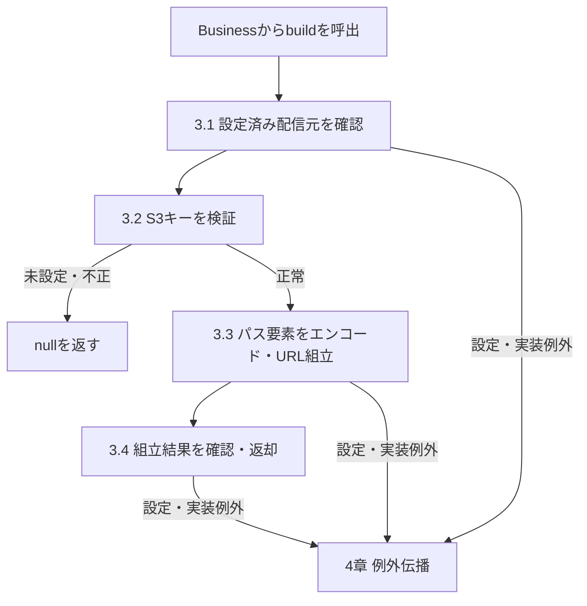

# COM001_11_画像URL生成

## 0. 処理フロー



## 1. 基本情報・責務

| 項目 | 内容 |
| --- | --- |
| ID／物理名 | COM001_11／build-product-image-url |
| 実装 | ProductImageUrlBuilder.build(String imageS3Key) |
| Controller／HTTP API | 作成しない。Businessから呼ぶ内部部品 |
| 設定 | productImageBaseUrl（環境ごとのHTTPS配信元） |
| 主な使用先 | APU002_01・02、APA002_01・02、APU005_02、APA004_02 |
| DB・外部通信 | なし。DB検索、S3 HEAD／GET、署名付きURL発行は行わない |

画像S3キーの検証とURL生成を行う。商品の公開可否・注文所有権の確認、どの画像キーを取得するかは各Businessで判定する。注文詳細の画像は今回の仕様どおり現在の商品画像を使用する。

画像配信元のアクセス制御は配信設計の責務。本機能はURLの生成だけを行い、画像が公開されてよいかを判断しない。No Image画像への切替はフロントエンドが行う。

## 2. 内部入力・使用方法

| 項目 | 型 | 必須 | 条件 |
| --- | --- | --- | --- |
| imageS3Key | String | 任意 | DBから取得した生のS3キー。URLやURLエンコード済みキーではない |
| productImageBaseUrl | 設定値 | 必須 | 起動時に検証・固定。リクエストから受け取らない |

リクエストJSONはない。以下は内部呼出例。

```java
// 共通機能使用：COM001_11
String imageUrl = productImageUrlBuilder.build(product.getImageS3Key());
```

| 入力例 | 戻り値例（配信元を https://images.example.com/ とした場合） |
| --- | --- |
| products/101/main.png | https://images.example.com/products/101/main.png |
| products/サンプル 1.png | https://images.example.com/products/%E3%82%B5%E3%83%B3%E3%83%97%E3%83%AB%201.png |
| null／空文字 | null |

## 3. 共通部品の処理

### 3.1 設定済み配信元を確認

起動時に設定をURIとして解析し、次を満たさなければ設定エラーで起動を中止する。正常な設定だけを不変の値として保持する。

| 判定対象 | 条件 |
| --- | --- |
| scheme | https |
| host | 存在すること。環境設定で許可した画像配信先 |
| userInfo・query・fragment | いずれもなし |
| port | 未指定または443 |
| path | 今回は空または「/」のみ。画像のプレフィックスはS3キーに含める |

正規化した配信元は末尾「/」を1個持つ。呼出時に設定が未初期化ならINTERNAL_ERROR。商品ごとに設定解析・外部通信をしない。

### 3.2 S3キーを検証

| 順序 | 条件 | 結果 |
| --- | --- | --- |
| 1 | nullまたは空文字 | 正常にnullを返す |
| 2 | Unicodeコードポイント数が512超過、UTF-8で1024バイト超過 | 不正キーとしてnull |
| 3 | 不正サロゲート、ISO制御文字を含む | 不正キーとしてnull |
| 4 | 先頭「/」、末尾「/」、連続「//」、バックスラッシュを含む | 不正キーとしてnull |
| 5 | 「/」区切りに空要素、完全一致の「.」「..」要素がある | 不正キーとしてnull |
| 6 | 上記以外 | 3.3へ |

キーをstrip・trim・URLデコード・Unicode正規化しない。生のキーと異なるオブジェクトを指さないため。%を含む文字列も生のキーとして扱い、%自体を次の処理でエンコードする。既にURLエンコードした値を渡すのは呼出元の誤り。

不正キーは商品全体のエラーにせずnullを返す。記録が必要な場合は **共通機能使用：COM001_09 安全なログ出力**。固定理由コードだけを記録し、生のキー・URLをログへ出さない。

### 3.3 パス要素をエンコード・URL組立

1. キーを「/」で分割する。
2. 各要素のUnicode文字列をUTF-8バイト列へ変換する。
3. ASCIIの `A-Z a-z 0-9 - . _ ~` のみそのまま残す。
4. それ以外の各バイトを「%」＋2桁の大文字16進表記へ変換する。
5. 要素を「/」で連結し、3.1の配信元の末尾へ連結する。

フォーム向けURLEncoderをそのまま使わない。空白は%20、+は%2B、%は%25、?は%3F、#は%23にする。UTF-8バイトは符号なし（byte & 0xff）として変換する。

URI.resolve等で入力キーを別URLとして解釈させず、検証済み配信元とエンコード済み相対パスだけを結合する。

### 3.4 組立結果を確認・返却

結果をURIとして解析し、scheme・host・portが設定済み配信元と一致し、userInfo・query・fragmentがないことを確認する。正常ならASCII形式のURL文字列を返す。

この時点で構文エラーやホスト不一致が起きた場合は実装・設定不備としてINTERNAL_ERROR。すべての例外を握りつぶしてnullにしない。実ファイルの存在は確認しない。

## 4. 例外・データ復旧

| 条件 | 戻り値・例外 | 外部応答へ変換する場合 |
| --- | --- | --- |
| キーなし・不正キー | null（正常終了） | 呼出元のdata内imageUrl=null |
| 配信設定不備 | 起動失敗。稼働後に検出した場合はINTERNAL_ERROR | data=null、汎用エラー |
| 想定外のURL生成例外 | INTERNAL_ERROR | data=null、汎用エラー |

**共通機能使用：COM001_08 共通例外変換。** 本部品からHTTP応答を直接書かない。捕捉可能なアプリケーション例外は呼出元APIからHTTP 200で返却する。

DB・S3を変更しないためロールバック・補償削除は不要。不正なDBキーの修復は商品編集等で行い、本機能が自動補正・書戻ししない。

## 5. 確認ケース

| 入力・状態 | 期待結果 |
| --- | --- |
| 通常キー、日本語・空白・+・%を含むキー | 正しいUTF-8パーセントエンコード |
| null・空文字 | null |
| /a、a//b、a/../b、a\\b、制御文字 | null |
| キー文字列に%2F | %252Fとして生成。スラッシュへデコードしない |
| http設定、query付き配信元 | 起動時エラー |
| S3上の実体がない | URL生成は正常。画面側でNo Image |
| 同じ入力を複数回呼出 | 同じURL。外部通信なし |

## 6. 返却項目

| 項目 | Java型 | null | 内容 |
| --- | --- | --- | --- |
| 戻り値 | String | 可 | 検証済みHTTPS画像URL。未設定・不正キーはnull |

呼出元APIの成功JSONへの組込み例（本部品のHTTP応答ではない）：

```json
{
  "imageUrl": "https://images.example.com/products/101/main.png"
}
```

例外が呼出元APIへ伝播した場合の共通応答例：

```json
{
  "requestId": "req-image-001",
  "data": null,
  "error": {
    "code": "INTERNAL_ERROR",
    "message": "処理を完了できませんでした。",
    "fieldErrors": []
  }
}
```
