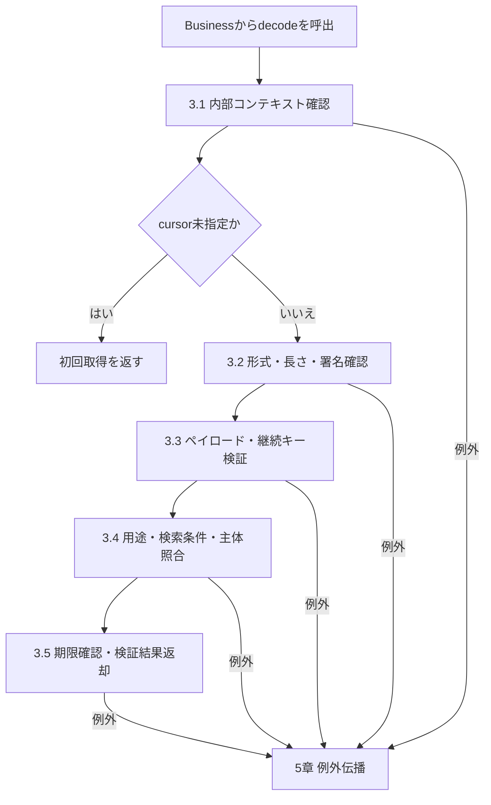
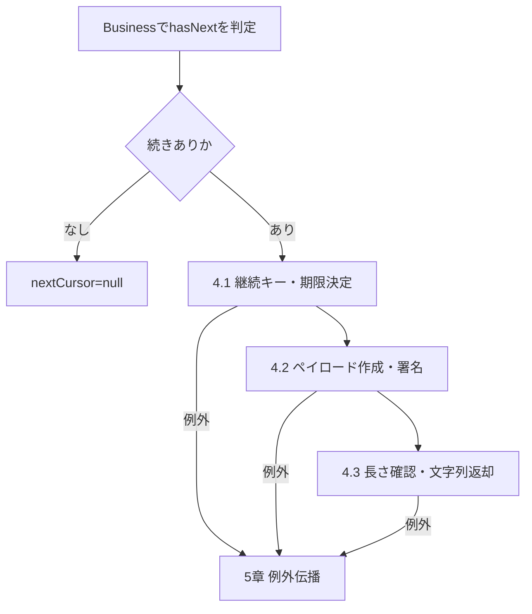

# COM001_12_カーソル生成・検証

## 0. 処理フロー

### 検証（一覧取得前）



### 生成（一覧取得後）



## 1. 基本情報・責務

| 項目 | 内容 |
| --- | --- |
| ID／物理名 | COM001_12／encode-decode-cursor |
| 実装 | CursorCodec（decode、encode、assertNotExpired） |
| Controller・HTTP API | 作成しない。Businessから呼ぶ内部部品 |
| 使用先 | APU002_01、APA002_01、APU005_01、APA003_01、APU006_02、APA004_01 |
| 検証 | 形式・署名・用途・条件・主体・期限・継続キー型 |
| DB・外部通信 | なし |
| 設定 | HMAC-SHA256署名キー、Clock、有効期間1800秒 |

| 共通部品に集約 | 各Businessに残す |
| --- | --- |
| カーソル生成・検証、条件ハッシュ作成 | 検索語のtrim・文字数・許可値等の入力検証 |
| 継続キーの型検証 | 並び順・取得件数、SQLの継続条件 |
| scope・主体・期限との照合 | 認証・所有権確認・DB検索 |
| 署名・エラー分類 | hasNext判定、最終返却行の選択 |

署名付きカーソルは改ざん検出用であり、認証の代わりにも、初回時点のDBスナップショットにもならない。Base64urlは暗号化ではない。

## 2. 内部入力・形式

### 2.1 メソッド

| メソッド | 入力 | 出力 |
| --- | --- | --- |
| decode | String cursor、CursorContext context | Optional<VerifiedCursor>。null入力はempty |
| encode | CursorKey lastReturnedKey、CursorContext context、Optional<VerifiedCursor> previous | String nextCursor |
| assertNotExpired | VerifiedCursor | 正常ならvoid、期限切れは例外 |

previousはdecode成功結果を同じ要求内で引き継ぐ。本部品だけが生成できる不変オブジェクトとし、クライアントのexp・JSONを直接渡して作らない。

### 2.2 CursorContextと固定プロファイル

contextは各APIがサーバーコードで構築する。リクエストからscope・並び順・期限・主体をそのまま受け取らない。

| プロファイル（scope） | キー型 | 検索条件 | 主体バインド |
| --- | --- | --- | --- |
| APU002_01 | ID_DESC | 正規化済みkeyword | なし（公開商品） |
| APA002_01 | ID_DESC | 正規化済みkeyword | なし（全管理者共通の商品範囲。認可は毎回実施） |
| APU005_01 | CONFIRMED_AT_ID_DESC | 空の条件Map | 必須：USERと認証済みDB会員ID |
| APA003_01 | CONFIRMED_AT_ID_DESC | 正規化済みkeyword・status（すべては空文字） | 必須：ADMINと認可済みDB管理者ID |
| APU006_02 | CREATED_OPERATION_DESC | status=PROCESSING（サーバー固定） | USER＋会員ID、またはGUEST＋解決済みカートID |
| APA004_01 | CREATED_SOURCE_OPERATION_DESC | status=PROCESSING（サーバー固定） | ADMIN＋管理者ID |

キー型・条件項目名・主体要否はこの登録表で決定する。未登録scopeは内部エラー。価格順などの追加は本表・キー型・各APIのORDER BYを一緒に設計変更し、任意キー・任意SQLを受け付けない。

| 内部項目 | 型・条件 |
| --- | --- |
| scope | 登録済み固定値 |
| keyword（商品一覧） | String、null不可。空文字は条件なし。入力検証済み |
| conditions（注文・未解決操作一覧） | Map<String,String>。null値なし。上表どおりのキー集合 |
| actorType・actorId（必要時） | 固定区分と正のLong。認証・DB検索の結果 |
| lastReturnedKey | ID_DESCは正のLong ID。注文型は確定日時＋注文ID。未解決操作型は3.3のキー集合 |

### 2.3 カーソルの外部形式

`Base64url(UTF-8 JSON).Base64url(HMAC署名)`。パディング「=」なし、全体2048文字以内。

商品一覧のペイロード（説明用。署名なしでは使用できない）：

```json
{
  "v": 1,
  "scope": "APU002_01",
  "lastId": "65",
  "queryHash": "<64桁の小文字hex>",
  "exp": 1794933000
}
```

注文一覧のペイロード：

```json
{
  "v": 1,
  "scope": "APU005_01",
  "lastId": "101",
  "lastConfirmedAt": "2026-11-17T09:30:00.123Z",
  "queryHash": "<64桁の小文字hex>",
  "actorHash": "<64桁の小文字hex>",
  "exp": 1794933000
}
```

認証情報・メール・氏名・検索語原文・会員ID原文をペイロードへ含めない。日時・商品／注文IDの継続位置は含むため、それ自体を秘密情報として扱う方式ではない。

商品一覧のv=1・項目・keywordハッシュは既存APU002_01／APA002_01と同じ形式を維持する。注文一覧では上記の複合型を使用する。既存の別形式があればCURSOR_INVALIDとして先頭から取得し直す。異なる形式を推測して複数回解析しない。

## 3. decodeの処理

### 3.1 内部コンテキスト確認

scope、固定プロファイル、必須の正規化済み条件・主体情報が揃っていることを確認する。内部引数不備はINTERNAL_ERROR。JWT・DB権限を本部品で確認し直さない。

cursor=nullならOptional.emptyを返す。空文字・空白だけは未指定に置換せずCURSOR_INVALID。trim・URL再デコードはしない。

### 3.2 形式・長さ・署名確認

| 順序 | 処理 | NG時 |
| --- | --- | --- |
| 1 | 1〜2048文字。「.」が1個、前後とも非空、各部分は[A-Za-z0-9_-]+ | CURSOR_INVALID |
| 2 | 2要素をBase64urlデコード。再エンコードして元文字列と一致を確認 | CURSOR_INVALID |
| 3 | 署名が32バイトであること | CURSOR_INVALID |
| 4 | 元のペイロード部分のASCIIバイト列にHMAC-SHA256を計算 | 設定・暗号処理異常はINTERNAL_ERROR |
| 5 | 計算署名と受信署名をMessageDigest.isEqualで比較 | 不一致はCURSOR_INVALID |

署名検証前にはJSON解析や継続キーの使用を行わない。2048文字上限をデコード前に適用する。

署名キーはデコード後32バイト以上の秘密値を起動時に取得・検証する。全ECSタスクで同じ有効キーを使用する。起動ごとの生成、ソース直書き、クライアントからのキー指定は禁止。Macインスタンスは要求ごとに作成し、共有可変インスタンスを複数スレッドから操作しない。

### 3.3 ペイロード・継続キー検証

UTF-8の不正バイト列を拒否し、JSONオブジェクトとして厳密に解析する。重複フィールド、未知フィールド、数値と文字列の自動型変換、過剰ネストを許可しない。

| 項目 | 正常条件 |
| --- | --- |
| v | JSON整数1 |
| scope | 文字列。context.scopeと完全一致 |
| lastId | 正の10進文字列、先頭0なし、Long範囲内 |
| queryHash | 64桁小文字hex |
| exp | JSON整数、正のLongのUTC Unix秒 |
| lastConfirmedAt | 注文型でのみ必須。UTC「yyyy-MM-dd'T'HH:mm:ss.SSS'Z'」の実在日時。厳密解析・再整形で同一になること |
| actorHash | 主体バインド型でのみ必須。64桁小文字hex |

全型共通はv・scope・queryHash・exp。商品型はlastId、注文型はlastId・lastConfirmedAt・actorHashを追加。未解決操作型はlastCreatedAt・lastOperationId・actorHash、管理者未解決操作型に限りlastSourceRankも追加。これ以外を拒否。時刻はSQL境界と同じ精度のUTC値、操作IDは小文字UUID v4、rankは整数0（画像）または1（業務）。各キーは降順。

取得した値をLong・Instantへ変換する。境界の商品の存在確認や注文検索はしない。

### 3.4 用途・検索条件・主体照合

queryHashの算出方式：

| 対象 | 方式 |
| --- | --- |
| 商品一覧 | 正規化済みkeywordのUTF-8バイト列をSHA-256、小文字hexにする。既存仕様を維持 |
| 注文・未解決操作一覧 | conditionsをキー昇順のJSONオブジェクトへ正規化し、専用コンテキストとともにHMAC-SHA256、小文字hexにする |

注文条件の正規化は、キー昇順・値は文字列のみ・空白なしJSONとする。文字列は二重引用符とバックスラッシュをエスケープし、U+0000〜001Fは小文字hexの「\\u00xx」形式、他のUnicodeはそのままUTF-8出力する。呼出元で検証した文字列をtrim・正規化し直さない。

HMACの対象バイト列はそれぞれ以下。連結する区切りはASCII NUL（0x00）。scopeは固定ASCII値とする。

- 注文条件：`query`＋NUL＋scope＋NUL＋正規化JSON。
- 主体：`actor`＋NUL＋scope＋NUL＋actorType＋NUL＋actorIdの10進文字列。

同一キーを使用するが先頭文字列で署名・条件・主体の用途を分離する。JSONペイロード署名の方式は3.2のまま。署名用秘密キーを用いた条件ハッシュで、注文検索語の単純な辞書照合を避ける。

queryHash、必要時actorHashが期待値と一致しなければCURSOR_INVALID。商品一覧の検索語SHA-256は暗号化でも秘匿化保証でもないため、個人情報を扱う検索APIへその方式を流用しない。

### 3.5 期限確認・検証結果返却

Clockから現在UTC Unix秒nowを取得し、`now < exp <= now + 1800`であることを確認する。時刻加算の桁あふれ等は内部エラー。期限切れ・不正期限はCURSOR_INVALID。

正常ならVerifiedCursorを返す。scope・検索条件・主体との結び付きを内部に保持し、別contextへの使い回しを防ぐ。フロントへこのオブジェクト全体を返さない。

DB検索中に期限を越える場合があるため、追加取得の応答作成終了時にBusinessからassertNotExpiredを呼ぶ。hasNext=falseでも確認する。期限を越えた場合は先頭再取得を案内する。

## 4. encodeの処理

### 4.1 継続キー・期限決定

| 入力 | 処理 |
| --- | --- |
| lastReturnedKey | 最終返却行のキー。余分に取得した次の1件のキーを使わない |
| 初回（previousなし） | exp＝現在UTC Unix秒＋1800 |
| 追加取得（previousあり） | previousのexpを継承。延長しない |

context・キー型・IDの正値・日時精度・previousとのcontext一致を確認する。内部入力不備はINTERNAL_ERROR。期限切れpreviousはCURSOR_INVALID。

複合型の日時はDBのTIMESTAMPTZ(3)をInstantへ変換した値をそのまま使用する。ミリ秒未満が残る値は切捨てず内部エラーとし、境界が変わることを防ぐ。正常日時はUTC固定3桁ミリ秒で整形する。

### 4.2 ペイロード作成・署名

1. v=1、scopeと3.3のプロファイル別境界キーを設定する。
2. 3.4と同じ方法でqueryHash・必要時actorHashを算出する。
3. 4.1のexpを設定する。
4. UTF-8のコンパクトJSONへ変換し、Base64url（パディングなし）にする。
5. そのBase64url文字列のASCIIバイト列をHMAC-SHA256で署名する。
6. 署名をBase64url化し、「ペイロード.署名」を作る。

生成時のフィールド順はv、scope、プロファイル別境界キー（商品：lastId／注文：lastId・lastConfirmedAt／未解決：lastCreatedAt・管理者のみlastSourceRank・lastOperationId）、queryHash、actorHash（該当時）、expに固定する。検証では受信したペイロード文字列に対して署名検証し、JSONを再シリアライズして署名を検証しない。

### 4.3 長さ確認・文字列返却

2048文字以内か確認し、超過はINTERNAL_ERROR（生成側の不備）。期限をもう一度確認してStringを返す。検証できない次カーソルを正常応答に含めない。

各APIの利用例：

```java
// 共通機能使用：COM001_12
Optional<VerifiedCursor> previous = cursorCodec.decode(command.cursor(), context);
// Business：継続キーをSQL引数に設定し、最大件数＋1件を取得
// Business：items・hasNext・lastReturnedKeyを決定
String nextCursor = hasNext
    ? cursorCodec.encode(lastReturnedKey, context, previous)
    : null;
previous.ifPresent(cursorCodec::assertNotExpired);
```

ID降順のSQLは`id < lastId`。注文日時降順＋ID降順では`confirmed_at < lastTime OR (confirmed_at = lastTime AND id < lastId)`相当を各Mapperで実装する。実際の物理カラム名は対象APIのDB定義に従う。本部品はSQLを生成しない。

## 5. 例外・データ復旧

| 条件 | code | message | fieldErrors |
| --- | --- | --- | --- |
| 受信カーソルの形式・署名・用途・条件・主体・期限・キー不正 | CURSOR_INVALID | 続きの情報を取得できません。先頭から再読み込みしてください。 | [] |
| 内部引数不備、生成不備、設定・暗号処理例外 | INTERNAL_ERROR | 処理を完了できませんでした。 | [] |

**共通機能使用：COM001_08 共通例外変換、COM001_09 安全なログ出力。** 内部理由を外部へ細分化しない。カーソル・ペイロード・検索語・主体識別値・秘密キーをログへ出さない。

DB変更・TX・ロック・外部通信がないため復旧更新は不要。CURSOR_INVALIDは実行済み検索条件を維持しcursorを外して先頭から取得する。DB障害は呼出元の例外であり、この部品が継続位置を進めたり自動再送したりしない。

署名キー変更で既存カーソルは無効となる。今回、複数世代キーの検証は実装しない。ローリング更新で異なるキーを混在させず全タスクへ同じ設定を適用し、利用者は先頭再取得で復旧する。

## 6. 確認ケース・実装資料

| ケース | 期待結果 |
| --- | --- |
| null／空文字 | 初回扱い／CURSOR_INVALID |
| 形式・署名改ざん、長さ超過 | CURSOR_INVALID、DB検索前に終了 |
| 商品一覧のscope違い | CURSOR_INVALID |
| keyword・状態フィルタ変更 | CURSOR_INVALID |
| 会員Aの注文カーソルを会員Bが使用 | CURSOR_INVALID。DB所有権条件も各APIで維持 |
| 同一日時の複数注文 | 日時＋IDの継続キーが保持される |
| 期限直前・期限と同時刻 | 有効／無効 |
| 追加取得の繰返し | 初回expを継承し延長しない |
| キーの変更・旧カーソル | CURSOR_INVALID、先頭から復旧 |
| 受信JSONの重複・未知項目・不正日時 | CURSOR_INVALID |
| 商品カーソルv1 | 既存項目・SHA-256条件ハッシュで互換性維持 |

実装資料：[MessageDigest](https://docs.oracle.com/javase/jp/21/docs/api/java.base/java/security/MessageDigest.html)、[Java暗号アルゴリズム名](https://docs.oracle.com/en/java/javase/17/docs/specs/security/standard-names.html)。HmacSHA256・SHA-256と署名比較を使用する。

## 7. 返却項目

### 7.1 Java内部の戻り値

| メソッド・項目 | 型 | 内容 |
| --- | --- | --- |
| decode戻り値 | Optional<VerifiedCursor> | 初回はempty。追加取得時は検証済み情報 |
| VerifiedCursor.key | CursorKey | IdKey(Long id) または ConfirmedAtIdKey(Instant confirmedAt, Long id) |
| VerifiedCursor.expiresAt | Instant | 次回生成時に維持する期限 |
| VerifiedCursor内部コンテキスト | 内部値 | scope・条件・主体の一致情報。利用者に返さない |
| encode戻り値 | String | nextCursor用の署名付き文字列 |
| assertNotExpired | void | 正常終了または例外 |

### 7.2 呼出元APIへの組込み例

```json
{
  "hasNext": true,
  "nextCursor": "<署名付きカーソル>"
}
```

例外の共通応答例（HTTP 200、本部品独自のHTTP APIはなし）：

```json
{
  "requestId": "req-cursor-001",
  "data": null,
  "error": {
    "code": "CURSOR_INVALID",
    "message": "続きの情報を取得できません。先頭から再読み込みしてください。",
    "fieldErrors": []
  }
}
```
