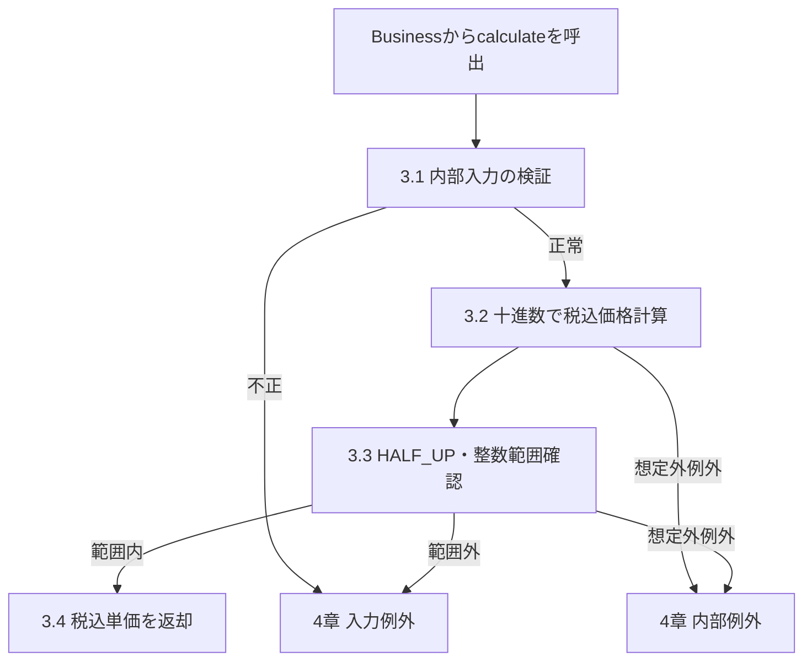

# COM001_13_税込価格計算

## 0. 処理フロー



## 1. 基本情報・責務

| 項目 | 内容 |
| --- | --- |
| ID／物理名 | COM001_13／calculate-tax-inclusive-price |
| 実装 | TaxInclusivePriceCalculator.calculate(Integer priceExcludingTax, Integer taxRate) |
| 使用先 | APA002_05（商品登録）、APA002_06（商品更新） |
| Controller・HTTP API | 作成しない。Businessから使用する計算部品 |
| 計算 | 税抜単価 ×（1＋税率÷100）、1円未満をHALF_UP |
| DB・外部通信 | なし |

商品入力の項目存在・JSON型・他項目との関連検証は各Businessで実施する。本部品は算術に必要な入力範囲を検証して計算する。販売・公開状態の判定、保存、TX管理は行わない。

商品一覧・商品詳細・カート・注文履歴では保存済み税込単価を使う。この部品を読取り時の価格再計算や過去注文金額の変更に使用しない。

## 2. 内部入力・使用方法

| 項目 | Java型 | 必須 | 範囲・意味 |
| --- | --- | --- | --- |
| priceExcludingTax | Integer | 必須 | 1〜9,999,999円。products.price_excluding_taxと一致 |
| taxRate | Integer | 必須 | 0〜32767。products.tax_rateの非負SMALLINT範囲。10は10% |

税率の型上の上限はDB保存可能範囲であり、業務上32767%を推奨・選択肢として表示する意味ではない。今後許可する税率を0・8・10等へ限定する場合は、商品登録・更新APIの入力条件として同時に反映する。現時点のDB CHECKにない限定を本部品で独自に追加しない。

リクエストJSONはない。内部入力イメージ：

```json
{
  "priceExcludingTax": 1800,
  "taxRate": 10
}
```

```java
// 共通機能使用：COM001_13
int priceIncludingTax = taxInclusivePriceCalculator.calculate(
    command.priceExcludingTax(), command.taxRate());
// この後、呼出元Businessが同一TXで3項目を保存する
```

## 3. 共通部品の処理

### 3.1 内部入力の検証

| 順序 | 条件 | NG時 |
| --- | --- | --- |
| 1 | 両項目がnullでない | VALIDATION_ERROR |
| 2 | priceExcludingTaxが1〜9,999,999 | VALIDATION_ERROR |
| 3 | taxRateが0〜32767 | VALIDATION_ERROR |

文字列の数値変換・小数から整数への丸めはしない。型変換は呼出元APIの入力処理で行う。既存DBの不正値を補正する用途ではない。DTOの@NotNull・@Min・@MaxとBusinessからのValidator呼出でも実装可能。COM001_03は使わない。

### 3.2 十進数で税込価格計算

```java
BigDecimal base = BigDecimal.valueOf(priceExcludingTax.longValue());
BigDecimal rate = BigDecimal.valueOf(taxRate.longValue()).movePointLeft(2);
BigDecimal raw = base.multiply(BigDecimal.ONE.add(rate));
```

浮動小数点のdouble・floatを経由しない。途中で税額を丸めず、最後に税込単価を1回だけ丸める。MathContextによる途中の有効桁数制限は設けない。

### 3.3 HALF_UP・整数範囲確認

```java
BigDecimal rounded = raw.setScale(0, RoundingMode.HALF_UP);
if (rounded.compareTo(BigDecimal.ONE) < 0
        || rounded.compareTo(BigDecimal.valueOf(Integer.MAX_VALUE)) > 0) {
    throw priceValidationException();
}
int result = rounded.intValueExact();
```

priceValidationExceptionはVALIDATION_ERRORの業務例外を生成する実装例。Integer範囲は1〜2,147,483,647。チェック後にintValueExactを使用し、intValueによる切捨て・桁あふれを許さない。

| 税抜価格 | 税率 | 計算前の税込値 | 返却 |
| --- | --- | --- | --- |
| 1800 | 10 | 1980 | 1980 |
| 104 | 10 | 114.4 | 114 |
| 105 | 10 | 115.5 | 116 |
| 100 | 8 | 108 | 108 |
| 100 | 0 | 100 | 100 |
| 9999999 | 32767 | 3286699671.33 | VALIDATION_ERROR（INTEGER範囲外） |

### 3.4 税込単価を返却

正のint値を呼出元へ返す。￥・カンマ・「税込」等の表示文字は付けない。SQLを実行せず、税抜単価・税率の元値を変更しない。

登録・更新Businessが税抜単価・税率・算出した税込単価を同一TXで保存する。商品数・注文数量を引数に追加せず、明細小計の計算は対象外とする。

## 4. 例外・データ復旧

| 条件 | code | message | fieldErrors |
| --- | --- | --- | --- |
| null・入力範囲不正・税込値のINTEGER超過 | VALIDATION_ERROR | 入力内容をご確認ください。 | [] |
| 計算・整数変換の想定外例外、実装不備 | INTERNAL_ERROR | 処理を完了できませんでした。 | [] |

正しい3.1・3.3の検証後に生じた想定外例外を一律に利用者の入力不正へ変換しない。入力値や最大値の内部詳細は外部エラーメッセージへ埋め込まない。

**共通機能使用：COM001_08 共通例外変換、COM001_09 安全なログ出力。** 本部品がHTTP応答やTX操作を行うことはない。

| 状態 | 復旧 |
| --- | --- |
| 本部品だけを実行 | DB変更なし。ロールバック・補償不要 |
| 呼出元の更新TX内で例外 | 例外を伝播。各Businessの定義に従い全更新をロールバック |
| DB保存前の計算失敗 | 保存を開始しない |
| 保存後に通信結果不明 | 本部品を直接再実行して再保存せず、対象APIの操作結果照会へ |

## 5. 確認ケース・実装資料

| ケース | 期待結果 |
| --- | --- |
| null・0円・負数・上限超過 | 入力例外 |
| 税率0・8・10 | 十進計算による正しい税込単価 |
| 小数部0.4・0.5 | 切捨て／切上げ |
| 入力は個別範囲内だが結果がINTEGER超過 | 入力例外。桁あふれなし |
| 同じ入力を繰り返す | 同じ結果。副作用なし |

Java API仕様：[BigDecimal](https://docs.oracle.com/javase/jp/21/docs/api/java.base/java/math/BigDecimal.html)。setScaleとintValueExactを使用する。DBの価格・税率・税込価格の範囲は現行products定義に合わせる。

## 6. 返却項目

| 項目 | Java型 | null | 内容 |
| --- | --- | --- | --- |
| 戻り値 | int | 不可 | HALF_UPで丸めた税込単価（円） |

呼出元のJSON項目への設定例：

```json
{
  "priceExcludingTax": 105,
  "taxRate": 10,
  "priceIncludingTax": 116
}
```

呼出元APIで捕捉した例外の応答例（HTTP 200）：

```json
{
  "requestId": "req-price-001",
  "data": null,
  "error": {
    "code": "VALIDATION_ERROR",
    "message": "入力内容をご確認ください。",
    "fieldErrors": []
  }
}
```
