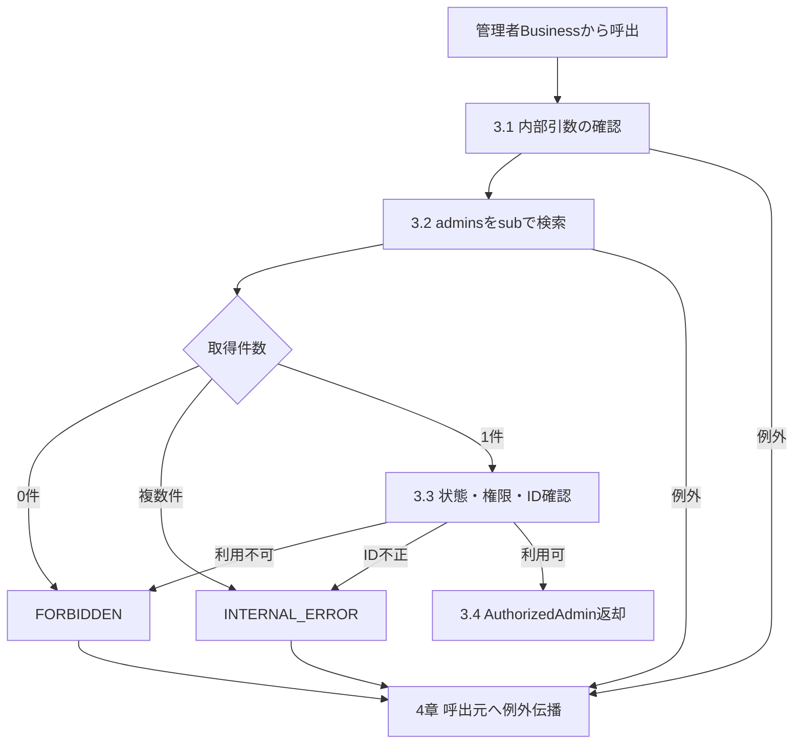

# COM002_01_管理者検索・利用権限確認

作成日：2026-11-17

## 0. 処理フロー



## 1. 基本情報・利用範囲

| 項目 | 内容 |
| --- | --- |
| ID・物理名 | COM002_01／require-active-admin |
| 実装部品 | AdminAccessService.requireActiveAdmin(AuthenticatedActor actor) |
| Mapper | AdminMapper.selectByCognitoSub |
| Controller・HTTP URL | なし。ECS内部の共通機能 |
| 呼出元 | 管理者の各Business |
| 使用先 | APA001_01、APA002_01〜08、APA003_01〜05、APA004_01（15 API） |
| 対象外 | AmplifyのAPA001_02・APA001_03、会員・ゲスト・非同期処理 |
| DB操作 | adminsのSELECTのみ |

**各APIは要求ごとに1回使用する。** クライアントに本共通機能用APIを追加で呼ばせない。ログイン時のAPA001_01の成功を後続APIの権限確認の代替にしない。

| 分担 | 担当 |
| --- | --- |
| JWT・共通ヘッダー・管理者プールの確認 | COM001_02等の共通認証受付 |
| adminsの存在、有効状態・管理者権限 | 本機能 |
| 商品・注文の存在、操作履歴の主体一致、版、状態遷移、在庫 | 各Business |
| 正常HTTP応答・例外変換 | COM001_07・COM001_08 |

親Controllerの認証受付と二重に呼び出さない。今回の呼出位置は各Businessの個別入力検証後、業務データの参照・更新・外部送信の前とする。

## 2. 内部入力・使用例

| 項目 | 型 | 必須 | 内容 |
| --- | --- | --- | --- |
| actor | AuthenticatedActor | 必須 | COM001_02で確認済みの認証主体 |
| actor.actorType | 区分 | 必須 | ADMIN |
| actor.subject | String | 必須 | 管理者Cognitoプールの検証済みsub |

リクエストJSONはない。Authorization・未検証のsub・メールアドレスを直接引数として受け取らない。ヘッダーの形式・文字数・署名検証を本機能で繰り返さない。

```java
// 各Businessから1回呼ぶ
AuthorizedAdmin admin = adminAccessService.requireActiveAdmin(actor);
// 成功した場合だけ、この後の業務処理へ進む
```

各API設計書では以下の記載に統一する。

> **共通機能使用：COM002_01 管理者検索・利用権限確認。**
> 入力：共通受付済み管理者actor。成功：AuthorizedAdminを受け取り次の処理へ。
> 例外：呼出元へ伝播し、業務処理を開始しない。

## 3. 共通部品の処理

### 3.1 内部引数の確認

| 判定 | 処理 |
| --- | --- |
| actorがnull、actorTypeがADMIN以外、subjectなし | INTERNAL_ERROR。内部の呼出・受渡し不備として終了 |
| 管理者actor・subjectあり | 3.2へ |

通常の不正JWTは前段で拒否済み。本機能に会員actorが渡された場合、会員用DB検索へ切り替えて続行しない。subjectの外部入力チェックの詳細はCOM001_02に集約する。

### 3.2 adminsをsubで検索

| 項目 | 内容 |
| --- | --- |
| テーブル | admins |
| 条件 | cognito_sub = actor.subject |
| 取得項目 | id、display_name、role、status |
| 一意性 | uk_admins_cognito_sub |
| ロック | FOR UPDATE・FOR SHAREなし |
| 更新 | INSERT・UPDATE・DELETEなし |

```sql
SELECT id, display_name, role, status
FROM admins
WHERE cognito_sub = #{subject,jdbcType=VARCHAR};
```

| DB項目 | Java型 |
| --- | --- |
| id | Long |
| display_name、role、status | String |

SQLではstatus・roleを絞り込まず、取得後に判定する。メールアドレスやCognitoグループによる代替検索はしない。Mapperは1件だけを黙って選ぶ実装にせず、多重取得例外も検出する。

| 取得結果 | 次処理 |
| --- | --- |
| 0件 | FORBIDDEN。管理者を自動登録しない |
| 1件 | 3.3へ |
| 複数件 | INTERNAL_ERROR |
| DB例外 | 4章。未登録・権限不足と区別する |

要求をまたぐ認可結果キャッシュは使用しない。Mapperの二次キャッシュ対象から外し、前回要求の許可結果を再利用しない。同じ要求で各層が重複して呼ばない。

### 3.3 状態・権限・ID確認

| 優先順 | 使用するDB項目 | 許可条件 | NG時 |
| --- | --- | --- | --- |
| 1 | admins.status・admins.role | status='ACTIVE' AND role='MASTER_ADMIN' | FORBIDDEN |
| 2 | admins.id | nullでなく1以上のLong | INTERNAL_ERROR |

DISABLED、未対応ロール、状態・ロールのnull・空文字・未知値は拒否する。未登録・無効・権限なしは同じ外部文言とし、内部条件は開示しない。

この確認はSELECT時点の状態に基づく。処理開始後の管理者無効化によって既に実行中の処理を強制停止する機能ではない。次の要求では最新状態で判定する。

### 3.4 AuthorizedAdmin返却

id・display_nameから不変のAuthorizedAdminを作成する。role・status・subは呼出元で再判定させるために返さない。

displayNameは表示を必要とするAPA001_01で検証する。本共通部品では表示名不正だけを理由に商品・注文APIを拒否しない。商品・注文BusinessはadminIdを操作主体の特定等に利用できるが、個々の操作履歴の所有権確認は別途行う。

## 4. 例外・データ復旧

本共通部品はHTTP応答を作らず、例外を呼出元へ伝播する。

**共通機能使用：COM001_08 共通例外変換、COM001_09 安全なログ出力。** HTTP応答はこれらの既存部品が担当する。

| 条件 | code | 共通の返却メッセージ | fieldErrors |
| --- | --- | --- | --- |
| 未登録・無効・権限なし | FORBIDDEN | この操作を実行する権限がありません。 | [] |
| 接続・タイムアウト等のDB一時障害 | SERVICE_UNAVAILABLE | 処理を完了できませんでした。時間をおいて再試行してください。 | [] |
| 内部引数不備、複数件、ID不正、SQL・マッピング不備、想定外例外 | INTERNAL_ERROR | 処理を完了できませんでした。 | [] |

例外のログにJWT・ヘッダー全文・sub・表示名・DB行全体を出力しない。requestId・機能ID・固定理由コード等で記録する。未知状態は利用拒否し、安全な内部ログで不整合を識別する。

| 項目 | 対応 |
| --- | --- |
| 本機能のDB変更 | なし。updated_atも更新しない |
| 本機能の復旧 | ロールバック・補償更新なし |
| 呼出元の更新TX | 境界・ロック・ロールバックは各Businessの責務。本機能は開始・commitしない |
| 一時障害 | 呼出元の取得・更新・結果照会仕様に従う。本部品が業務処理を自動再送しない |
| 未登録・データ不整合 | 運用で修復。本機能がCognito照会や自動登録を行わない |

## 5. 確認ケース

| ケース | 期待結果 |
| --- | --- |
| ACTIVEかつMASTER_ADMIN、正のid | AuthorizedAdminを返す |
| adminsなし | FORBIDDEN、自動登録なし |
| DISABLED・未知role/status | FORBIDDEN、業務処理を開始しない |
| DB障害 | SERVICE_UNAVAILABLE等。FORBIDDENにはしない |
| 会員actor・actorなし | INTERNAL_ERROR。別領域で続行しない |
| 表示名のみ不正 | 認可成功。APA001_01の表示項目検証で拒否、商品APIは表示名を使用しない |
| 前回成功後に管理者無効化 | 次回要求で拒否 |
| 同じ要求の呼出 | 各Businessが1回呼び、後続処理へ結果を渡す |

## 6. 返却項目

### 6.1 正常戻り値（Java内部）

| 項目 | Java型 | null | 保証・用途 |
| --- | --- | --- | --- |
| AuthorizedAdmin | 不変DTO | 不可 | 利用可能な管理者であることを確認済み |
| adminId | Long | 不可 | admins.id。正の値。操作主体・表示IDの元 |
| displayName | String | 可 | admins.display_nameの取得値。表示APIで内容を検証 |

DB定義ではdisplay_nameはNOT NULLだが、内部DTOでは欠損を許容して認可と表示の責務を分ける。JSONへのID文字列化・表示名検証は呼出元APIで行う。

### 6.2 異常戻り値

正常DTOは返さず4章の例外を送出する。共通例外変換後の外部応答例は以下。これは呼出元APIのレスポンスであり、本共通部品の独立HTTP応答ではない。

```json
{
  "requestId": "req-admin-001",
  "data": null,
  "error": {
    "code": "FORBIDDEN",
    "message": "この操作を実行する権限がありません。",
    "fieldErrors": []
  }
}
```
