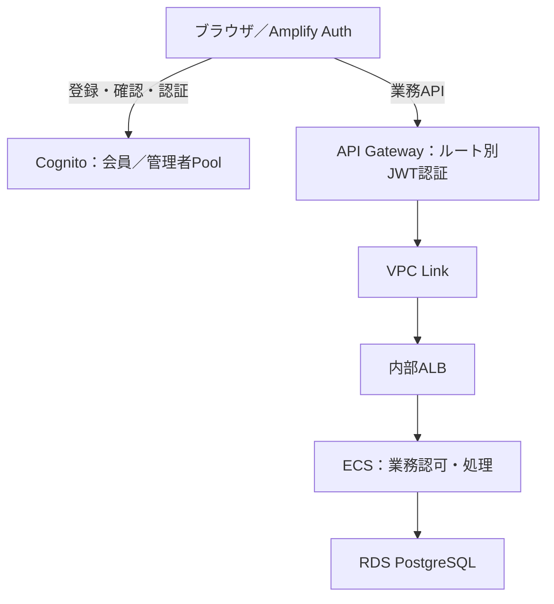

# 04 認証・セキュリティ設計

改訂日：2026-11-14  
対象：HTML＋CSS＋JavaScript、Amplify Auth、Cognito、API Gateway HTTP API、ECS（Spring Boot）、PostgreSQL。AWS構成はCDK（Java）で管理する。

## 1. 認証方式・責務

**Cognito＋Amplify Auth＋API Gateway JWT Authorizer方式を採用する。** ECSは会員初期化・利用状態・管理者権限・所有権等の業務処理を担当する。

| 担当 | 実行内容 |
| --- | --- |
| Cognito | 認証、確認メール、トークン発行・更新 |
| Amplify Auth | 独自画面からの認証操作、トークン管理・取得・更新 |
| API Gateway | 認証対象ルートのJWT検証。会員用・管理者用Authorizerを分離 |
| ECS | 検証済み主体の確認、利用状態・権限・所有権の確認、業務処理 |
| RDS | users・admins・カート・注文等の業務データ。認証セッションは保存しない |

### 1.1 廃止した旧方式

- ECS独自のログイン・新規会員登録・認証ログアウトAPI。
- Spring Session JDBCと認証セッションテーブル。
- USER_SESSION／ADMIN_SESSION／ec_user_session／ec_admin_session等の独自認証Cookie。
- ECS側の「ログイン成功から絶対12時間」という期限管理。
- バックエンド専用App ClientによるADMIN_USER_PASSWORD_AUTH前提。
- Cognitoトークンのサーバー側永続保管。

ゲストカート識別Cookieは業務用途として継続する。

## 2. Cognito・App Client

| 項目 | 会員Pool | 管理者Pool |
| --- | --- | --- |
| 分離 | 独立User Pool | 会員と別のUser Pool |
| ログインID | メールアドレス | メールアドレス |
| 登録 | Amplify AuthのsignUpで直接登録 | 自己登録なし。初期運用でマスター1名作成 |
| メール確認 | Cognito標準メール・確認コード | 初期作成手順で確認状態を管理 |
| App Client | ブラウザ用Public Client、secretなし | 管理者専用Public Client、secretなし |
| ログイン画面 | 独自画面 | 独自画面 |
| Hosted UI／Managed login | 使用しない | 使用しない |
| DB側確認 | usersの利用状態・本人データの所有権 | 事前登録adminsの有効状態・管理者権限 |

- Pool・App Client・Authorizer・認証フロー設定はCDKで管理する。
- 認証フローはAmplifyのパスワード認証に対応させる。USER_SRP_AUTHを候補とし、SDKバージョンとALLOW_USER_SRP_AUTH等の設定を実装時に確認する。
- Pool ID／App Client IDはフロントに配置する公開識別情報。client secretやAWS秘密鍵は配置しない。
- Gateway・ECSは受け入れるPool・Clientを設定で固定する。ブラウザ指定のPoolを信用しない。
- 管理者のメール・パスワードはCDKソース・contextへ置かない。Cognitoとadminsへの事前登録を別の運用手順で行う。
- 初回パスワード変更challengeが画面未対応のまま残らないよう、初期管理者の状態を確認する。
- Cognito Groupは必須としない。採用時はCDK管理とし、adminsによる権限確認との役割を明示する。
- パスワード再設定・MFA設定変更画面は今回の対象外。Cognito側の回復方法・MFA設定は未対応challengeを生じさせない構成として別途確定する。

## 3. 会員登録・ログイン後の処理

### 3.1 会員

1. signUpで氏名・メール・パスワードをCognitoへ送信する。
2. confirmSignUpでメール確認する。この時点ではRDSへ登録しない。
3. 確認後はログイン画面へ戻る。確認完了だけで自動ログインしない。
4. signIn成功後、アクセストークンを取得する。
5. **APU001_01：POST /api/v1/users/initialize**を呼ぶ。
   - 検証済み会員subでusersを検索する。
   - 未登録の場合のみCognito属性を取得・照合し、同期的に登録する。
   - 既存会員は利用状態を確認して情報を取得する。氏名・メールを毎回上書きしない。
   - 会員検索はCOM001_04、利用状態判定はCOM001_05に従う。
6. 必要に応じて**APU003_05：POST /api/v1/cart/merge**でゲストカートを統合する。

初期化・統合失敗をCognito認証失敗と混同しない。統合失敗時は認証・統合元を維持して再試行できるようにする。RDS会員登録用のSQS／Lambda非同期処理は使用しない。

### 3.2 管理者

1. 管理者PoolのAmplify AuthでsignInする。
2. **APA001_01：GET /api/v1/admin/auth/me**でadminsの有効状態・権限を確認する。
3. 確認成功後に管理画面へ進む。認証成功だけで業務操作を許可しない。

管理者を自動DB登録しない。会員・管理者の認証設定、保存領域、キャッシュ、signOutの対象を分離する。単一のグローバル設定切替だけで同時ログインを維持できるとは扱わず、実装で検証する。

## 4. API Gateway・ECSの信頼境界

### 4.1 ルートごとの認証

| 区分 | GatewayのJWT認証 | ECS側の確認 |
| --- | --- | --- |
| 公開商品一覧・詳細 | なし | 公開・未削除条件、公開可能な項目 |
| ゲストカート経路 | なし | ゲストCookie、有効期限、対象カート、更新時のOrigin／CSRF |
| 会員業務API | 会員用Authorizer | 会員sub、利用状態、所有権 |
| 管理者業務API | 管理者用Authorizer | 管理者sub、adminsの有効状態・権限 |
| 会員カート統合 | 会員用Authorizer | 会員・統合元ゲストの双方、Origin／CSRF |

機能一覧の「API Gateway認証」列と同期する。ゲスト用URLは一覧に残る案をAPI設計時に確定する。不正な会員JWTをゲスト処理へ自動でフォールバックさせない。

### 4.2 JWT・主体情報

- ブラウザはAuthorization: Bearerで**アクセストークン**を送信する。IDトークンを業務API認証に使用しない。
- Gatewayは署名・issuer・audience（aud／client_id）・期限・設定したscopeを検証する。
- JWT Authorizerだけでtoken_use=accessを必ず判別できるとは扱わない。実際に発行されるscopeに整合するルート設定と、COM001_02の検証済みtoken_use等の確認を組み合わせる。
- SRP等の直接ログインで得るscopeとOAuthカスタムscopeを混同しない。必要scopeとApp Client認証方式をセットで検証する。
- 検証済みclaimsから主体用ヘッダーを設定し、クライアント指定の同名値を上書きする。具体名・マッピングはCOM001_02と同期する。
- 公開経路ではクライアント指定の主体用ヘッダーを信用せず、除去または未認証として扱う。
- API Gateway→VPC Link→内部ALB→ECSを業務API経路とする。Security Group等でALB／ECSへの直接到達を防ぐ。
- CloudFront→ALB専用ヘッダーだけをJWT検証済みの根拠にしない。保護APIに認証を迂回できる経路を残さない。

### 4.3 ECS

認証受付はステートレスに構成し、フォームログイン・HttpSessionで認証状態を保存しない。

共通ヘッダー・主体確認はCOM001_02、会員検索はCOM001_04、会員利用状態はCOM001_05を使用する。注文・カートの所有権は各Businessで確認する。管理者確認はadmins用に分離する。

## 5. トークン・ログイン期間・ログアウト

| 項目 | 方針 |
| --- | --- |
| 管理 | Amplify Authで管理。ECS／RDSへ認証トークンを永続保存しない |
| API呼出前 | fetchAuthSession等でアクセストークンを取得し、SDKの更新結果を扱う |
| Access／ID token期限 | Cognito App Clientで設定。具体値未確定 |
| Refresh token期限 | Cognito App Clientで設定。具体値未確定 |
| 旧12時間制御 | 独自アプリセッションの固定期限としては採用しない |
| Rotation | 採否・SDK対応・更新／失効動作を合わせて確定 |
| ブラウザ保存方式 | localStorage／sessionStorage等の選択とログイン維持範囲を実装前に確定 |

Amplifyの使用だけで業務上のログイン期間が決まるわけではない。Cognitoの期限・保存方式・トークン更新の成否で決まる。

### 5.1 ログアウト

- 対象側のAmplify signOutと、会員情報・注文・入力・復元キャッシュの破棄を行う。
- 片方のログアウトで、もう一方の認証情報を削除しない。
- DBの会員カート・注文・操作履歴は保持する。ECSの認証セッション削除APIは作成しない。
- HttpOnlyゲストCookieはJavaScriptから削除できない。ログアウト時の解除は専用業務処理で別途設計する。
- signOut・失効操作だけで、Gatewayの署名・期限検証が発行済みJWTを即時拒否するとは保証しない。利用停止はECSのDB状態判定でも拒否する。
- 即時失効が必要な場合は追加の失効確認方式を検討する。現時点では追加採用しない。

### 5.2 ブラウザ・ログの保護

- トークン・パスワード・確認コード・ゲスト識別値をログ／URL／エラー詳細へ出さない。
- XSS対策として外部入力をテキスト表示し、不要なHTML実行を避け、CSP・外部スクリプトを管理する。
- JavaScriptから参照できる保存領域を、HttpOnly Cookieと同等の保護と説明しない。
- 機密応答はCache-Control: no-storeとし、CloudFront等で会員間の応答を共有キャッシュしない。

## 6. ゲストCookie・CSRF・CORS

| 項目 | 方針 |
| --- | --- |
| Cookie名 | ec_guest_cart_token（名称案。共通カート設計で統一） |
| 用途 | ゲストカート識別のみ。会員認証には使用しない |
| 属性 | Secure、HttpOnly、SameSite=Lax、Domain省略を基本案とする |
| Path | ゲスト操作・会員カート統合の両経路で送信される範囲。具体値はAPI経路と合わせて確定 |
| 期限 | carts.expires_atを正とし、明細更新成功時から7日 |
| 延長しない操作 | 参照・失敗・結果照会・同一操作の再送 |
| 解除 | カート統合成功確定時。ログアウト時の解除方法は別途設計 |

Cookie Pathは認可境界としない。DB側の種別・所有関係を確認し、ゲスト識別値で任意の会員カートを操作させない。

- Bearer認証だけのAPIへCookie認証用CSRF処理を一律適用しない。
- ゲストCookieを伴う更新・統合・識別解除にはOrigin検証とCSRF対策を行う。SameSiteだけに依存しない。
- CSRFトークンの発行・受け渡し方法は共通API設計で確定する。
- CORSの許可Originを環境別に明示し、Cookie付き通信にワイルドカードOriginを使わない。
- Authorization、Content-Type、必要なCSRFヘッダーとOPTIONSの扱いを設定する。
- クロスサイト配置を採用する場合はSameSite・credentialsを再設計する。CORSは認証・認可の代替ではない。

## 7. パスワード・メール確認

### 7.1 パスワード

| 区分 | 内容 |
| --- | --- |
| 既定の画面要件 | 16〜30文字、半角英大文字・英小文字・数字を各1文字以上、記号任意、空白不可 |
| Cognito設定 | 最小16文字、英大文字・英小文字・数字必須。記号必須は無効 |
| ログイン入力 | トリム・変換しない |
| 未確定 | 最大30文字・半角限定・空白不可をサーバーでも厳密に強制するか |

Cognito標準だけでは既定要件をすべて強制できない。ECS登録APIは廃止したため、「登録APIで追加検証する」という旧設計は適用しない。

**実装負荷を抑える提案：** 画面では既定要件を検証し、サーバーの強制条件はCognito標準ポリシーの範囲とする。Cognito直接呼び出しで画面制約を回避できる点を明記する。この保証範囲の変更は未確定。厳密な強制が必要なら認証構成・要件を再検討し、フロント検証だけで強制済みとしない。

### 7.2 メール確認

- Cognito標準確認メールを使用する。独自SES送信は現時点で追加しない。
- signUp／confirmSignUp／resendSignUpCodeはAmplifyから実行する。
- 通常ログインのたびに登録用メール確認を行わない。MFA等とは区別する。
- RDS会員作成は初回ログイン後のAPU001_01で同期的に行う。

## 8. IAM・CDK・運用

| 管理対象 | 内容 |
| --- | --- |
| CDK | 2つのPool・App Client、メール確認・パスワード設定 |
| Gateway | 2系統Authorizer、認証対象ルート、scope、CORS、claims受け渡し |
| ネットワーク | VPC Link、内部ALB、ECS到達制限、プライベートRDS |
| Spring Boot | ステートレス受付・認可。Spring Session JDBCは導入しない |
| IAM | deploy／execution／task／必要なLambda／EC2 SSMのroleを分離 |
| 管理者初期登録 | Cognito・adminsへの登録手順。認証情報はIaCへ直書きしない |

秘密値をGit、CloudFormation Outputs、CDK context、ログに記載しない。必要なSecretの参照・保管には最小権限を適用する。

ECS task roleには実際に使うAWS操作だけを付与する。旧ログイン用AdminInitiateAuth権限を不要なまま残さない。初期化時のCognito GetUserはアクセストークンを用いる処理として設計し、そのトークンを永続保存しない。

## 9. エラー・検証

### 9.1 エラーの境界

| 発生元 | 扱い |
| --- | --- |
| Amplify／Cognito | SDK例外・nextStepを画面用文言へ対応付ける |
| Gateway等 | 401／403／429／5xx等。ECS共通JSONを前提にしない |
| ECS | 応答生成可能な例外はHTTP 200＋error.code。COM001_08と共通エラー一覧に従う |
| 通信断 | 結果不明。認証失敗・未登録・更新失敗と断定しない |

### 9.2 確認項目

- 会員／管理者JWTの取り違え、署名不正・期限切れ・Client不一致・IDトークンを拒否する。
- 主体ヘッダー偽装やALB／ECS直達で認証を迂回できない。
- 公開・ゲスト経路はJWTなしで使えるが、ゲスト識別不正・期限切れは拒否する。
- 会員／管理者の同時ログインと片方だけのログアウトが成立する。
- 確定した期限・保存方式でトークン更新成功／失敗・ブラウザ再起動を確認する。
- 会員初期化の同時登録競合、DISABLED・PENDINGの拒否を確認する。
- カート統合失敗時に認証・統合元が維持される。
- ゲストCookie付き更新・統合のOrigin／CSRF違反を拒否する。
- ゲスト期限は更新成功時だけ延長される。
- ログ・キャッシュ・エラー応答に認証情報が残らない。

## 10. 実装前の確定事項

| 項目 | 現状 |
| --- | --- |
| 会員／管理者の各トークン期限 | 具体値未確定。旧12時間・管理者1時間を確定値として引き継がない |
| ブラウザ保存方式・会員／管理者の分離 | 未確定 |
| Rotation・SDK・認証フロー | 組み合わせて確定 |
| scope・claimsヘッダー | COM001_02・IaCへ具体化 |
| パスワードのサーバー保証範囲 | 7.1の提案を確認 |
| ゲストCookieのログアウト時解除 | 専用業務処理を確定 |
| ゲスト経路・Cookie Path・CSRF方式 | 共通カート・API設計と同期 |
| Cognitoの回復方法・MFA | 今回の画面対応範囲と合わせて確定 |

## 11. 参照資料・改訂履歴

### 11.1 プロジェクト資料

- [機能一覧・API Gateway認証列](https://docs.google.com/spreadsheets/d/1_3cp7E1CKQ3fda4SCl4G7kGrbhWOb3ZThdh4oUXIS2s/edit#gid=2026111201)
- [DB設計書・認証／会員初期化方針](https://docs.google.com/spreadsheets/d/1Ka2DV7_iX2cCcRSIbu7-sHf4spx2TAV8p5SXogauFX8/edit#gid=631343214)
- COM001_02、COM001_04、COM001_05、APU001_01の各設計書。

他資料に残る旧API番号・Spring Session・HTTP 403/409/503等は、最新機能一覧・共通エラー方針と同期して扱う。

### 11.2 AWS公式資料

- [App ClientとPublic Client](https://docs.aws.amazon.com/cognito/latest/developerguide/user-pool-settings-client-apps.html)
- [HTTP API JWT Authorizer](https://docs.aws.amazon.com/apigateway/latest/developerguide/http-api-jwt-authorizer.html)
- [Amplifyのセッション管理](https://docs.amplify.aws/javascript/frontend/auth/manage-user-sessions/)
- [Cognitoパスワードポリシー](https://docs.aws.amazon.com/cognito/latest/developerguide/managing-users-passwords.html)
- [Cognito認証フロー](https://docs.aws.amazon.com/cognito/latest/developerguide/amazon-cognito-user-pools-authentication-flow-methods.html)

### 11.3 改訂履歴

| 日付 | 内容 |
| --- | --- |
| 2026-11-14 | Cognito＋Amplify Auth＋API Gatewayへ更新。Spring Session・独自認証Cookie・固定12時間期限を廃止。同期会員初期化、ゲストCookie、信頼境界、エラー区分、未確定事項を追記。 |

