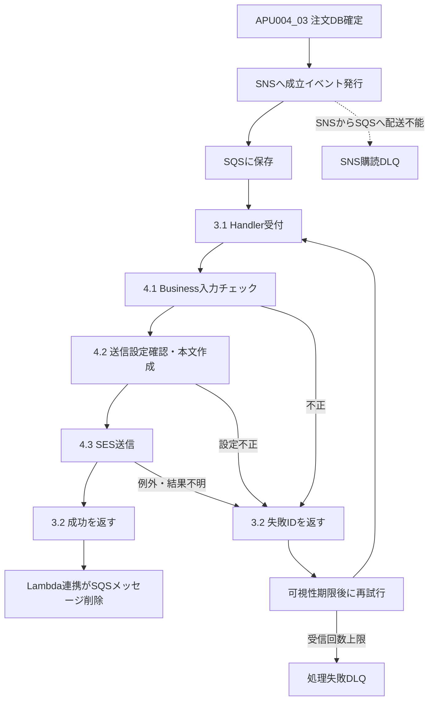

# BAT001_01_購入完了メール送信

改訂日：2026-11-16。SESサンドボックス継続・解除申請なしで確定。アプリ独自のテスト宛先リストを廃止。

## 0. 処理フロー



SNS発行自体の失敗はECSで記録する。SNSが受け付けていないイベントはDLQに入らない。メール送信は注文・在庫の更新と独立させる。

## 1. 基本情報・採用範囲

| 項目 | 内容 |
| --- | --- |
| 機能ID／旧ID | BAT001_01／API-B01 |
| 物理名 | send-order-completed-email |
| 実行基盤 | Java Lambda。SQSイベントソースマッピングから起動 |
| Handler | OrderCompletedEmailHandler |
| Business | SendOrderCompletedEmailBusiness |
| HTTP Controller／API Gateway | 使用しない。公開HTTP APIを追加しない |
| 外部呼出 | AWS SDK for Java v2のSesV2Client.sendEmail |
| DB | 検索・登録・更新・削除なし。RDS接続なし |
| 機能 | 成立したテスト注文の購入完了メールを1宛先へ送る |
| 対象外 | 状態自動更新、在庫操作、実決済、カード保持、外部Webhook、HTMLメール、添付、利用者向け再送画面 |

### 1.1 実装コストを抑える方針

外部通知先が未指定のため、受信システムの開発を要しないSESメールを採用する。既存Webhookが利用できる場合はそちらの方が小さくなる可能性がある。今回はSESで確認済みのテスト宛先だけを使用する。

- Cognitoの登録確認メールは引き続きCognito標準。購入完了メールとは別系統。
- LambdaはVPCに接続せず、イベント内の最小項目で本文を生成する。通知用のNAT・RDS接続・DBテーブルを追加しない。
- DBへの配信記録・Outbox・厳密な重複排除は実装しない。デモとして通知漏れ・重複の可能性を許容する。
- SESのAPI受付成功は受信箱への到達保証ではない。画面に「メール配信済み」と表示しない。
- 注文受付→手配中→発送済みは従来どおり管理者操作。

## 2. 入力イベント

SNS Standard Topic `order-completed-events` → SQS Standard Queue `order-completed-email`。
SNS購読はRaw Message Deliveryを有効にし、SQS bodyに以下のJSONを格納する。

### 2.1 項目・単項目チェック

BusinessでJSONをDTOへ変換し、Bean Validationと個別範囲判定を実施する。未定義項目・重複JSONキー・型不一致は不正とする。

| 項目 | 型 | 必須 | 条件 |
| --- | --- | --- | --- |
| schemaVersion | integer | ○ | 1固定 |
| eventType | string | ○ | ORDER_COMPLETED固定 |
| eventId | string | ○ | ORDER_COMPLETED:{orderId}と完全一致 |
| orderId | string | ○ | 正のBIGINT。半角数字1〜19桁、先頭0・符号不可、Long上限内 |
| operationId | string | ○ | 英数字・ハイフン・アンダースコア、1〜64文字 |
| orderNumber | string | ○ | ORD-{orderId}と完全一致（最大23文字） |
| recipientEmail | string | ○ | 1〜254文字、メール形式、改行なし。@NotBlank、@Size、@Email＋改行判定 |
| totalAmountIncludingTax | string | ○ | 正のBIGINT。orderIdと同じ数値書式 |
| testOrder | boolean | ○ | true固定 |

SQSのmessageIdはHandlerが取得するAWS管理の識別子。本文eventIdとは別物。入力本文の最大サイズはUTF-8で4KiBとする。

### 2.2 項目間チェック

| 条件 | 判定 |
| --- | --- |
| eventIdとorderIdが不一致 | 送信しない。入力不正 |
| orderNumberとorderIdが不一致 | 送信しない。入力不正 |
| testOrderがtrue以外 | 送信しない。入力不正 |

### 2.3 SQS body例

```json
{
  "schemaVersion": 1,
  "eventType": "ORDER_COMPLETED",
  "eventId": "ORDER_COMPLETED:501",
  "orderId": "501",
  "operationId": "4df45f8d-bb7a-4ce5-9d49-e5d0d5d34687",
  "orderNumber": "ORD-501",
  "recipientEmail": "buyer@example.com",
  "totalAmountIncludingTax": "4460",
  "testOrder": true
}
```

例のアドレスは説明用。実装時は送信者・受信者ともSESで確認したテストアドレスを設定する。Cognitoでメール確認済みでもSESサンドボックスの宛先確認を済ませたことにはならない。

## 3. Handler

### 3.1 SQSレコード受付

| 順序 | 処理 |
| --- | --- |
| 1 | SQSEvent.Recordsの各messageId・bodyを取得 |
| 2 | messageIdとbodyをBusinessへ渡す。Recordsが空なら送信せず空の失敗配列を返す |
| 3 | レコードごとに例外を捕捉し、失敗したmessageIdだけを保持 |
| 4 | 想定外例外も該当レコード失敗とする。messageId自体が取れない等、応答生成不能時はHandlerを異常終了 |

イベントソース側でReportBatchItemFailuresを有効にする。HandlerはSQS DeleteMessageを直接呼ばない。

### 3.2 処理結果返却

| Business結果 | Handler動作 |
| --- | --- |
| SES受付成功 | 失敗配列に追加しない |
| 入力不正・設定不備・SES例外 | messageIdをbatchItemFailuresへ追加 |
| Handler全体異常終了・タイムアウト | バッチ全体を失敗として再試行対象にする |

**共通機能使用：COM001_09 安全なログ出力。** Lambdaで利用可能な共通ロガーとして組み込み、HTTPコンテキストへの依存を持たせない。eventId、orderId、operationId、SQS messageId、SES messageId、固定理由コード、AWS requestIdのみを記録する。イベント本文・メール本文・メールアドレス・生のSDK例外文は出力しない。

HTTP用共通レスポンス・例外変換は使用しない。例外時HTTP 200の規約は本機能の対象外。

## 4. Business

### 4.1 入力チェック

2章の検証を実行する。不正ならSESを呼ばず例外を返す。数値型へ変換後、本文用金額を3桁区切りへ整形する。金額の税計算・再集計は行わない。

### 4.2 送信設定確認・本文作成

| 設定 | 内容 |
| --- | --- |
| SES_REGION | SES送信者確認を実施したリージョン |
| MAIL_FROM_ADDRESS | SES確認済み送信者。改行なしのメール形式 |
| MAIL_ENABLED | 明示的にtrueの場合のみ送信。false・未設定時は送信せず設定エラー |

宛先はイベントのrecipientEmail（注文時にorders.purchaser_emailへ保存した会員登録メールアドレス）を使用する。アプリ独自の宛先リスト・固定宛先への置換は行わない。LambdaからSESの確認メール発行API・確認状態取得APIを呼ばず、SendEmailの成否を処理する。設定不備を検知した場合はイベントソースを停止して設定修正後に再開し、失敗メッセージの無駄な消費を防ぐ。

件名：`【テスト注文】ご注文受付のお知らせ`

本文（UTF-8プレーンテキスト）：

```text
テスト注文を受け付けました。

注文番号：{orderNumber}
注文時の合計金額：￥{totalAmountIncludingTaxの3桁区切り}（税込）

注文内容・現在の状況はショップのマイページでご確認ください。
※これはテスト注文です。実際の決済・請求・商品発送は行われません。
※このメールは注文受付時の情報です。その後のキャンセル等は注文履歴をご確認ください。
```

氏名・住所・電話・商品明細・認証情報は本文へ含めない。注文情報はECSがDB確定値から作ったイベントを使い、Lambdaでは再検索しない。

### 4.3 SESへの送信

| SES SendEmail項目 | 設定値 |
| --- | --- |
| FromEmailAddress | MAIL_FROM_ADDRESS |
| Destination.ToAddresses | recipientEmail 1件 |
| Content.Simple.Subject | 上記固定件名・UTF-8 |
| Content.Simple.Body.Text | 4.2の本文・UTF-8 |
| その他 | CC／BCC／添付／返信先なし |

- Lambda実行ロールで認証。固定アクセスキーやSMTPパスワードを保存しない。
- SDKのAPI全体タイムアウト10秒、1試行タイムアウト5秒、SDK自動リトライは0回とする。再試行はSQS側に集約する。
- SendEmail正常応答のMessageIdを取得したら受付成功とする。
- 例外・応答欠損・タイムアウトは失敗としてHandlerへ返す。送信済みの可能性がある場合も成功と断定しない。
- SES受付後のログ出力失敗だけを理由に送信をやり直さない。

## 5. 例外・復旧

| 発生箇所 | 固定ログ理由コード | 返却／復旧 |
| --- | --- | --- |
| DTO不正・未知イベント | EVENT_INVALID | 該当messageIdを失敗返却。上限後DLQ。生成側修正後に再投入 |
| SESで受信者未確認による送信拒否 | MAIL_SEND_FAILED | 失敗返却。上限後DLQ。運用者がSESで宛先確認を完了後、対象イベントを再投入。注文は再作成しない |
| 設定欠損 | MAIL_CONFIG_INVALID | 失敗返却。設定修正・連携再開 |
| SES制限・一時障害 | MAIL_SEND_FAILED | 失敗返却。可視性期限後に再試行 |
| SES権限不足・送信者未確認 | MAIL_SEND_FAILED | 失敗返却。IAM・SES設定修正後に再投入 |
| SES通信タイムアウト | MAIL_SEND_UNKNOWN | 失敗返却。再送で重複する可能性を記録 |
| Lambda停止・強制終了 | Lambdaエラー | SQS再試行、上限後DLQ |
| SNSからSQSへの配送失敗 | SNS配送メトリクス | SNS購読DLQ。購読・Queue Policy修正後に配送を復旧 |
| ECSのSNS発行失敗・COMMIT直後停止 | ORDER_NOTIFICATION_PUBLISH_FAILED（ログ可能な場合） | 注文成功維持。成立注文のDB記録から運用者がイベントを再構成してSNSへ発行 |

### 5.1 データ復旧・重複

本LambdaはDB更新を行わないためDBロールバック・在庫復元は不要。メールを送っても注文状態は変えない。

SNS／SQSは重複配送し得る。eventIdは追跡用であり、保存先がないため重複排除の保証はない。SES受付直後のLambda停止でも重複送信し得る。デモ用途として許容し、本番運用向けの「必ず1通」は保証しない。

Outboxなしのため注文COMMITからSNS受付までの通知漏れを自動検出・修復できない。再投入は管理者が成立注文を確認して実施し、注文確定APIの再実行を復旧手段にしない。既存の注文成功を返すリプレイ要求では再通知しない。

## 6. AWS CDK設定・運用条件

| リソース | 設定案 |
| --- | --- |
| SNS | Standard Topic。ECSタスクロールのみPublishを許可 |
| SQS購読 | Raw Message Delivery=true。Queue PolicyのSourceArnを対象SNSに限定 |
| メインSQS | Standard、保持4日、VisibilityTimeout180秒、暗号化SSE-SQS |
| Lambda処理DLQ | 保持14日、maxReceiveCount=5。監視対象 |
| SNS購読DLQ | 処理DLQとは別に作成、保持14日、対象SNSからの配送のみ許可 |
| Lambda | VPC接続なし、タイムアウト30秒、BatchSize=1、バッチ待機0秒 |
| イベントソース | ReportBatchItemFailures有効。初期は低頻度の手動テストで使用 |
| IAM | Lambdaに対象Queueの受信・削除・属性取得、確認済み送信元に限定したses:SendEmail、必要なログ権限 |
| CloudWatch | メインQueue滞留・DLQ件数・Lambdaエラー・SNS配送失敗を監視。ログ保持14日 |
| SES | サンドボックスのまま使用。解除申請は今回行わない。送信元とテスト購入者のアドレスをSESで確認。Cognito標準確認メールは継続 |
| ECS疎通 | SNS APIへHTTPS到達が必要。既存の外向き通信経路を使用。なければSNS VPC Endpoint等の設計・費用を別途確認 |

SNS Topicも保存時暗号化を有効にする。採用鍵に応じたSNSサービス・ECSの権限をCDKで設定する。イベントにメールアドレスを含むためQueue／DLQ閲覧と再投入権限を限定する。

SESサンドボックスは最大200通／24時間、1通／秒。今回のテストはこの範囲内で実施し、集中投入・DLQ一括再投入はしない。Lambdaの同時実行数制御だけで送信レートを保証できるわけではなく、SESのスロットリングは失敗返却・再試行で扱う。

送信料のみの参考：SES à-la-carteは1,000通あたり0.10米ドル（100通なら0.01米ドル）。SNS・SQS・Lambda・ログ・暗号化鍵・ネットワーク等は別料金。選択プランと無料枠で変わるため、無料前提にしない。専用IP・添付・受信メール機能は追加しない。

公式資料（2026-11-16確認）：
- https://aws.amazon.com/ses/pricing/
- https://docs.aws.amazon.com/ses/latest/dg/request-production-access.html
- https://docs.aws.amazon.com/lambda/latest/dg/services-sqs-configure.html
- https://docs.aws.amazon.com/lambda/latest/dg/services-sqs-errorhandling.html
- https://docs.aws.amazon.com/sns/latest/dg/sns-dead-letter-queues.html

### 6.1 SESの事前設定（運用者・メール受信者が実施）

購入処理とは別に、利用するAWSアカウント・SES_REGIONで以下を実施する。Lambdaへの確認ロジック実装は不要。

| 手順 | 担当 | 作業 |
| --- | --- | --- |
| 1 | 運用者 | SESコンソールのIdentitiesからCreate identityを選び、送信元アドレスを登録 |
| 2 | 送信元メール受信者 | AWSからの確認メールのリンクを開き、確認を完了 |
| 3 | 運用者 | テスト購入者が会員登録に使用するメールアドレスを同様にSESへ登録 |
| 4 | テスト購入者 | AWSからの確認メールのリンクを開く |
| 5 | 運用者 | SESで確認済みになったこと、Lambdaの送信元・リージョン・送信権限を確認 |

同じアドレスの確認を購入のたびに行う必要はない。購入者のメールアドレスを変更した場合は、新しい宛先もSESで確認する。Cognitoの会員登録時のメール確認はSESの確認を代替しない。SES未確認でも会員登録・モック注文は成立可能だが、購入完了メールは送信できない。

### 6.2 購入時の自動処理

1. 購入者が購入ボタンを押す。
2. APU004_03が在庫等を検証し、モック決済・注文・在庫・カート更新をDBで確定する。
3. ECSが注文時点の購入者メールアドレスを含むイベントをSNSへ発行する。
4. SNS → SQS → Lambdaの連携でSendEmailを実行する。
5. SESが事前確認済みの購入者のメールアドレスへ送信する。

注文完了画面はメール送信・到着を待たない。メール送信失敗で注文を取り消さず、利用者に再注文を求めない。注文成立前やロールバック時は通知しない。

## 7. 確認観点

| ケース | 期待結果 |
| --- | --- |
| 確認済みテスト宛先の注文成立 | 注文成功後にメールが届き、注文状態は注文受付のまま |
| 注文ロールバック | SNS発行もメールもなし |
| 同一注文要求の成功結果再取得 | 追加のSNS発行なし |
| 本文不正 | SES呼出なし。再試行後DLQ |
| 形式が正しいがSES未確認の購入者メール | SendEmailが拒否される。注文成功維持、再試行後DLQ。SES確認後に再投入 |
| SESで確認済み・アプリへの宛先登録なし | 独自リストはないため、その購入者メールへ送信可能 |
| SES一時障害 | 注文成功維持、SQS再試行 |
| SNS発行失敗 | 注文成功維持、安全なログ。DLQだけでは回収できないと確認 |
| 重複イベント | 同じeventIdのメールが重複し得る。DB・在庫に影響なし |
| 送信済み直後のLambda停止 | 重複可能性を許容し、注文API再実行をしない |

## 8. 返却項目

HTTPレスポンス・フロント向けJSONは返さない。Lambdaからイベントソースマッピングへ返却する。

| 項目 | 型 | 内容 |
| --- | --- | --- |
| batchItemFailures | array | 失敗したSQSレコード。全件成功時は空配列 |
| batchItemFailures[].itemIdentifier | string | 失敗レコードのSQS messageId。orderId／eventIdを入れない |

正常時：
```json
{"batchItemFailures":[]}
```

1件失敗時：
```json
{"batchItemFailures":[{"itemIdentifier":"sqs-message-id-001"}]}
```

例外詳細・メールアドレス・内部理由コードは返却せず、安全なログに限定する。

